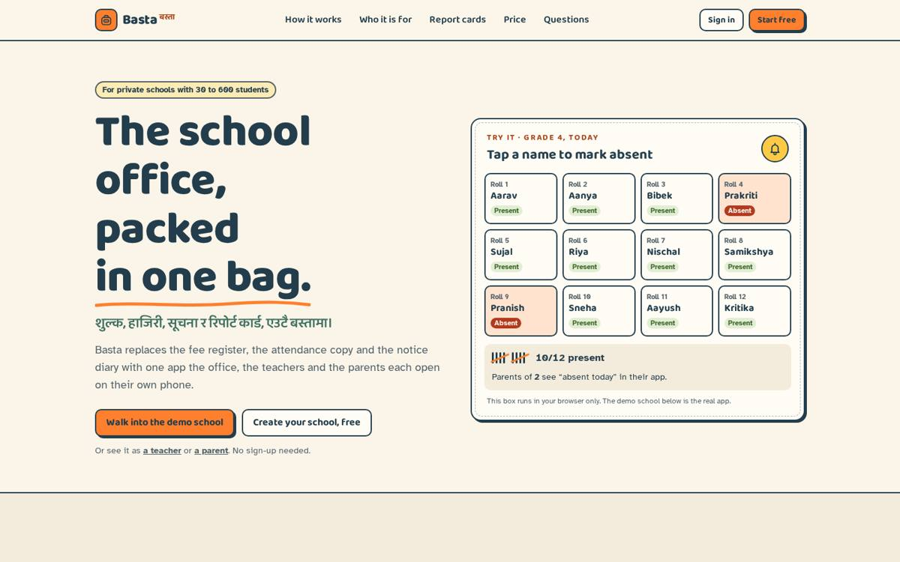
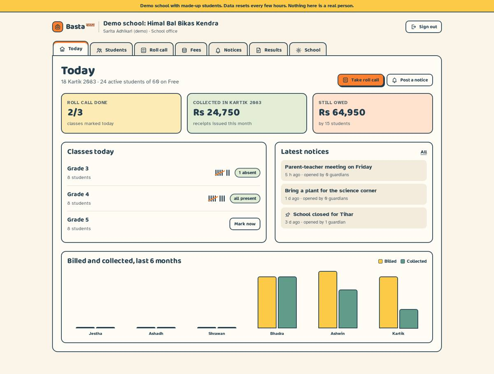

# Basta (बस्ता) · the school office, packed in one bag

Fees, roll call, notices and report cards for small private schools in Nepal, with separate logins for the office, teachers and parents.

**Live:** https://basta-school.sites.tab.bot/ (open the demo school as office, teacher or parent; no sign-up needed)

Day 4 of Nabin Babu Uranw's 100 platforms in 100 days.




## What it does
- **Roll call:** teachers mark absentees in a tap (present by default), correct the same day, and see a Bikram Sambat month register.
- **Fees:** each class has a monthly fee; generate a month's dues for every student in one tap (never billed twice), add exam/transport charges, record payments (cash, bank, eSewa, Khalti, Fonepay, cheque), print numbered receipts (BS-2083-0042) with the amount in words, cancel with a reason, see who owes, and send a WhatsApp reminder in Nepali or English.
- **Notices:** to the whole school or one class, pinned or not, with "opened by X of Y guardians".
- **Results:** exams, subjects with full marks, a marks grid that refuses impossible marks, CDC/NEB letter grades and GPA, a printable report card with term attendance, published to parents only when the office says so.
- **Parents:** sign up with the 8-character family code, see today's attendance, the month calendar, dues, receipts, notices and published report cards. Several children per parent.
- **Roles:** school office (everything), teacher (no money), parent (own child only), platform admin (schools, plans, people, audit trail).

## Stack
React 18 + Vite + TypeScript + Tailwind CSS (no UI kit, own icon set, CSS motion), one Cloudflare Worker that serves the API and the SPA, Cloudflare D1 (SQLite) as the database. D1 replaces PostgreSQL/Prisma so the whole thing runs at $0. Own auth: PBKDF2 password hashing with WebCrypto, HttpOnly session cookies, rate limits, origin checks, role checks on every route.

## Run locally
```
npm ci
npm test          # API tests (node 22.18+, uses node:sqlite)
npm run build     # typecheck + SPA + worker bundle into dist/site
```
`dist/site` is a Worker bundle (`_worker.js` + assets) that needs a D1 binding named `DB`.

## Design
Direction "Tactile Satchel": school-supplies tactility (thick ink outlines, press-down buttons), name-label stickers, tally marks, binder divider tabs. Palette Coolors "Sunrise Glow" 233D4D · FE7F2D · FCCA46 · A1C181 · 619B8A. Type: Baloo 2 + Atkinson Hyperlegible. See [docs/DESIGN.md](docs/DESIGN.md).

## Business
Free up to 60 students; Pro Rs 1,499/month per school up to 600 students (switched on manually, no online checkout yet). See [docs/BUSINESS.md](docs/BUSINESS.md).

## Honest limits
Not a government or board system; no online fee payment; no SMS; grade bands follow the published letter-grading table, check your board's latest rules. The demo school uses made-up names and resets every 3 hours.

## License
MIT. Fonts under the SIL Open Font License.
